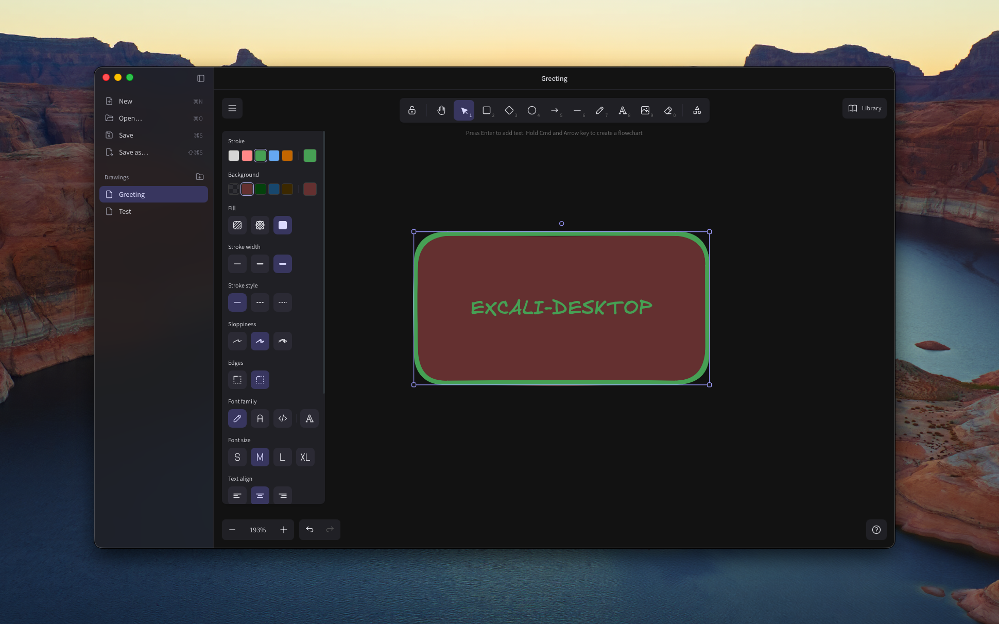

<p align="center">
  
</p>

<h1 align="center">Excali Desktop</h1>

<p align="center">
  <strong>A local, offline Excalidraw editor.</strong>
</p>

## Install

Run the following command to build and install Excali Desktop in `~/Applications` on your computer.

```sh
bun run desktop:build && mkdir -p ~/Applications && rm -rf ~/Applications/"Excali Desktop.app" && ditto src-tauri/target/release/bundle/macos/"Excali Desktop.app" ~/Applications/"Excali Desktop.app"
```

## Run

Install [Bun](https://bun.sh/) 1.4.0+, Rust, and the [Tauri prerequisites](https://v2.tauri.app/start/prerequisites/) for your operating system. On macOS, install Xcode Command Line Tools with `xcode-select --install`.

```sh
bun install --frozen-lockfile
bun run desktop
```

The installation step copies bundled Excalidraw fonts into `public/fonts`. They are included in the app, so editing does not require a CDN, account, or server. Internet access is required to install dependencies, not to use the built editor.

Bun manages dependencies and runs the JavaScript tooling and tests; Node.js is not required. Vite builds the frontend, and Tauri still uses Rust and the system webview for the desktop app. Faster tooling does not directly change the app's runtime performance. Commit `bun.lock` when changing dependencies.

## Use

Drawings live in `~/.excali-desktop`. The sidebar shows that folder as a tree of folders and drawings; click a drawing to open it.

- **New** creates a blank drawing. **Save** puts a new drawing in the selected folder as "Untitled" (or "Untitled 2", …) and lets you name it right away.
- The folder button next to **Drawings** creates a folder inside the selected one. Click **Drawings** to target the top level again.
- Double-click a drawing or folder, or use its pencil button, to rename it. Enter confirms; Escape cancels.
- **Open** uses a native file picker for `.excalidraw` files (and Excalidraw JSON) anywhere on disk. Files outside `~/.excali-desktop` stay where they are and are listed under **Other locations** in the sidebar so you can reopen them later; the × button removes one from the list without touching the file. Files saved with **Save as…** outside the drawings folder are listed there too.
- **Save** writes back to the open file.
- **Save as…** saves a copy at a new location and makes it the active document.
- Each open drawing gets a tab above the canvas. Opening a drawing that is already open switches to its tab; a blank, untouched tab is reused instead of left behind. Close a tab with its × button, a middle click, its right-click menu, or Cmd/Ctrl+W (Shift+Cmd/Ctrl+W closes the window).
- Ctrl+Tab and Ctrl+Shift+Tab move between tabs; Cmd/Ctrl+1–8 jump to a tab and Cmd/Ctrl+9 to the last one.
- Cmd/Ctrl+N (new tab), Cmd/Ctrl+O, Cmd/Ctrl+S, and Cmd/Ctrl+Shift+S are supported. Save and Save as apply to the current tab.
- The application asks you to save, discard, or cancel before closing a modified drawing, including when quitting, once for each modified tab.

### Presentations

Every frame is a slide. Draw frames with the frame tool (F), then press **Present** (⇧⌘P / Shift+Ctrl+P) in the sidebar or the play button at the top right of the canvas.

- **Slides** at the top right of the canvas opens the slides panel: drag thumbnails, or use ⌥↑/⌥↓ on a focused one, to reorder them. Click a slide to go to it; double-click to present from it.
- With a slide or anything on it selected, the panel sets how the slide comes in (**Move** flies the camera across the canvas, **Dissolve** crossfades, **Cut** is instant), the speed, and whether to skip it when presenting.
- **Builds** reveal a slide one step at a time. Select elements on a slide and pick a build number; elements with the same number appear together, with a Fade, Rise, or Appear effect. The build list selects a build's elements and moves builds earlier or later.
- While presenting: → / Space / Enter or a click goes to the next build or slide, ← / Backspace or a right-click goes back, ⇧→/⇧← skip whole slides, Home/End jump to the ends, a number followed by Enter jumps to that slide, L toggles the laser pointer, B or W blanks the screen, ? lists the shortcuts, and Esc ends the presentation.

Slides are shown fullscreen and letterboxed to each frame's shape. Slide order, transitions, and builds are saved in the drawing (in the elements' `customData`), so they travel with the file; excalidraw.com ignores them. Presenting never modifies the drawing. With reduced motion turned on in the system settings, transitions and builds are instant.

Use Open for drawings and Excalidraw's Insert image tool for images. File drag-and-drop is not supported in this first version. The canvas is temporarily inactive during file operations.

Each tab keeps its own undo history while it is open. Images are embedded in saved files. Saves use a temporary file in the destination folder and replace the destination only after the complete write succeeds.

Everything the app stores lives in `~/.excali-desktop`: your drawings, plus a hidden `.app` folder with the recovery snapshot (`recovery.json`) and the list of files opened from other locations (`linked.json`). A recovery snapshot left by an earlier version in the OS application-data folder is moved there on first launch.

Unsaved edits are debounced into the recovery snapshot approximately 800 ms after the last edit. A crash can lose edits made since the latest snapshot. The snapshot covers every tab with unsaved edits. At startup, each one is restored as an unsaved document in its own tab; save it to keep it. Recovery is removed after a successful save or an explicit discard. This is crash recovery, not version history.

## Build

```sh
bun run desktop:build
```

On macOS the app is generated at `src-tauri/target/release/bundle/macos/Excali Desktop.app`. The current bundle target is a macOS `.app`; Windows/Linux packaging targets and signing should be configured when those distributions are needed.

## Frontend preview

```sh
bun run dev
```

Open `http://127.0.0.1:5173`. The browser preview imports drawings through a file input and saves through downloads; it cannot overwrite desktop files. Recovery uses local storage in this mode. Use the desktop command for native file persistence.

## Checks

```sh
bun run build
bun test
cargo test --manifest-path src-tauri/Cargo.toml
cargo clippy --manifest-path src-tauri/Cargo.toml --all-targets -- -D warnings
```

The small tests cover invalid-document rejection, ordered recovery writes after failures, and replacement of existing files. Native file dialogs and quitting should also be checked interactively on each target OS.

## Boundaries

No document version history, sync, or account system yet. Presentations have no presenter view or speaker notes, and slides can't be exported to PDF. Deleting and moving drawings is done in Finder for now; the sidebar refreshes when the window regains focus. Files modified externally are not watched; saving will replace the current file. The core editor and fonts are local; the production content-security policy blocks remote resources and embedded web pages.

Excalidraw and the other dependencies retain their respective licenses. This wrapper is not an official Excalidraw application.
